# Our Wallets API — Backend & Architecture Guide

> **Our Wallets** is a modern, high-precision financial management application designed for tracking personal and shared finances, cash flows, wallet accounts, investments, debts & receivables, budgets, and savings goals within a household.

This repository hosts the backend API for **Our Wallets**, built with **Bun**, **TypeScript**, and **NestJS**, adhering to a **Pragmatic Testable Feature/Module-Based Architecture**.

---

## Table of Contents

1. [System Overview & Domain Concepts](#1-system-overview--domain-concepts)
2. [Entity Relationship Diagram (ERD) & Schema](#2-entity-relationship-diagram-erd--schema)
3. [Architecture Principles & Reference Structure](#3-architecture-principles--reference-structure)
4. [Layer Responsibilities & Boundary Rules](#4-layer-responsibilities--boundary-rules)
5. [Coding & Naming Conventions](#5-coding--naming-conventions)
6. [Testing Strategy](#6-testing-strategy)
7. [Rule Addition Policy](#7-rule-addition-policy)

---

# 1. System Overview & Domain Concepts

### 1.1 Household & Multi-Tenant Access

- **Household**: Satuan unit keluarga yang menaungi beberapa `user`.
- **Roles**:
  - **Admin** (Kepala Keluarga, e.g., _Bayu_): Memiliki kendali penuh atas household, kategori, wallet, budget, dan pengaturan anggota.
  - **Member** (Pasangan/Anggota Keluarga, e.g., _Annisa_): Memiliki akses terisolasi pada data household dan hanya dapat mencatat transaksi pada wallet yang di-assign oleh Admin.
- **Granular Permission**: `can_edit_others_transactions` menentukan apakah seorang member diizinkan mengedit/koreksi transaksi milik member lain.
- **Household Invites**: Mengundang anggota baru menggunakan kode/link undangan (`household_invites`) yang memiliki batas kedaluwarsa (`expires_at`).
- **Quick Role Switcher**: Switcher instan di header aplikasi (`Bayu (Admin)` vs `Annisa (Member)`) untuk kemudahan pengujian prototype.

### 1.2 Unified Ownership Pattern

Setiap entity finansial utama (**Wallet**, **Investasi**, **Utang/Piutang**, **Budget**, **Goal**) mengadopsi pola kepemilikan eksklusif:

- Kolom: `owner_user_id` **atau** `owner_household_id`.
- **Constraint**: Salah satu wajib diisi, tidak boleh keduanya (ditegakkan via check constraint database).

### 1.3 Wallets, Access, & Reconciliation

- **Wallet Types**: `bank`, `ewallet`, `cash`.
- **Shared Access (`wallet_access`)**: Akses wallet bersama diatur 1 level via tabel `wallet_access`. Begitu di-assign oleh admin, member dapat melihat dan mencatat pergerakan dana di wallet tersebut.
- **Rekonsiliasi Wallet (`wallet_reconciliations`)**: Pengecekan manual antara saldo tercatat di sistem vs saldo aktual di rekening/fisik kapan saja, mencatat `adjustment_transaction_id` bila ada selisih.
- **Balance Snapshots (`wallet_balance_snapshots`)**: Snapshot saldo otomatis pada akhir periode (e.g., bulanan) untuk kalkulasi histori grafik net worth.

### 1.4 Categories, Transactions, & Transfers

- **Kategori (`categories`)**: Milik household dan dikelola oleh Admin. Satu kategori dapat digunakan untuk `income` maupun `expense`. Kategori sistem (`is_system`) tidak dapat dihapus, hanya disembunyikan (`is_hidden`).
- **Pemisahan Owner vs Recorded By**:
  - `transactions.owner_id`: Siapa pemilik dana/beban transaksi (digunakan untuk filter mode _Saya / Pasangan / Gabungan_).
  - `transactions.recorded_by`: Siapa user yang menginput transaksi.
- **Transfers (`transfers`)**: Entity mandiri terpisah dari `transactions` untuk perpindahan saldo antar wallet (termasuk pencatatan `fee`). Mencegah double-counting income/expense yang dapat merusak kalkulasi cashflow dan net worth.
- **Void & Correction Pattern**: Tidak ada _hard delete_ pada mutasi keuangan (`transactions`, `transfers`, `debt_payments`, `investment_transactions`). Setiap mutasi memiliki `status` (`active`/`void`) dan `correction_of_id` (self-referencing ID ke record asli yang dikoreksi).

### 1.5 Debts & Receivables (Utang / Piutang)

- Digabung dalam tabel `debts` dengan pembeda `type` (`utang` / `piutang`).
- **Ownership Split**: Memiliki split kepemilikan tanggungan via 2 kolom tetap: `portion_admin` dan `portion_member`.
- **Pembayaran (`debt_payments`)**: Riwayat cicilan/pelunasan tercatat bertahap. Member hanya dapat melakukan pembayaran melalui wallet yang telah di-assign padanya.

### 1.6 Investments

- **Pemisahan Transaksi & Valuasi**:
  - `investment_transactions`: Riwayat jual/beli unit aset yang terhubung langsung ke `wallet_id` sebagai sumber/tujuan dana.
  - `investment_valuations`: Riwayat pergerakan harga pasar aset per unit (`price_per_unit`), mendukung sumber harga (`source`: `manual`, `scrape`, `api`).
- **Asset Types**: `emas`, `perak`, `crypto`, `saham`.

### 1.7 Budgets, Goals, & Wallet Reservations

- **Budgets (`budgets`)**: Pengeluaran berkala per kategori per periode (`weekly`, `monthly`, `yearly`).
  - Tiap periode aktif dimodelkan di `budget_periods`.
  - **Carried Deficit**: Defisit pada suatu periode **tidak hangus** saat reset, melainkan terbawa (`carried_deficit`) untuk membebani target periode berikutnya.
- **Goals (`goals`)**: Akumulasi dana menuju target nominal tertentu (`target_amount`) tanpa reset periodik, memiliki `target_date` opsional dan status (`active`, `completed`, `cancelled`).
- **Reservasi Dompet (`reservations`)**: Menghubungkan wallet ke budget/goal secara _many-to-many_ untuk menghitung **"Saldo Bebas"** (_Free Balance_ = Saldo Aktual - Total Reserved Amount).
  - Metode alokasi: `manual` (nominal tetap), `percentage` (% dari setiap income masuk), atau `formula` (JSON config generik).
- **Encroachment / Soft-Lock (`budget_encroachments`)**:
  - Reservasi bersifat informational: transaksi tetap diizinkan dieksekusi meskipun saldo bebas menjadi minus (tidak ada hard block).
  - Namun ketika saldo bebas terlampaui, sistem **wajib** meminta user memilih budget/goal mana yang "termakan" beserta split nominalnya.
  - Tercatat di `budget_encroachments` dan mengurangi `reserved_amount` terkait agar histori penurunan target dapat ditelusuri.
  - Notifikasi peringatan (Toast / Alert) dimunculkan saat encroachment terjadi.

### 1.8 Polymorphic Audit Logs

- Tabel `audit_logs` menyimpan log perubahan lintas entitas (`actor_id`, `entity_type`, `entity_id`, `action`, `before_data`, `after_data`, `created_at`).

---

# 2. Entity Relationship Diagram (ERD) & Schema

```mermaid
erDiagram
  USERS ||--o{ HOUSEHOLD_MEMBERS : joins
  HOUSEHOLDS ||--o{ HOUSEHOLD_MEMBERS : has
  HOUSEHOLDS ||--o{ HOUSEHOLD_INVITES : issues
  USERS ||--o{ WALLETS : owns
  HOUSEHOLDS ||--o{ WALLETS : owns
  WALLETS ||--o{ WALLET_ACCESS : grants
  USERS ||--o{ WALLET_ACCESS : has
  WALLETS ||--o{ WALLET_RECONCILIATIONS : has
  WALLETS ||--o{ WALLET_BALANCE_SNAPSHOTS : has
  HOUSEHOLDS ||--o{ CATEGORIES : defines
  CATEGORIES ||--o{ TRANSACTIONS : classifies
  WALLETS ||--o{ TRANSACTIONS : records
  USERS ||--o{ TRANSACTIONS : owns_and_records
  WALLETS ||--o{ TRANSFERS : source_of
  WALLETS ||--o{ TRANSFERS : destination_of
  USERS ||--o{ DEBTS : owns
  HOUSEHOLDS ||--o{ DEBTS : owns
  DEBTS ||--o{ DEBT_PAYMENTS : has
  WALLETS ||--o{ DEBT_PAYMENTS : via
  USERS ||--o{ INVESTMENTS : owns
  HOUSEHOLDS ||--o{ INVESTMENTS : owns
  INVESTMENTS ||--o{ INVESTMENT_TRANSACTIONS : has
  WALLETS ||--o{ INVESTMENT_TRANSACTIONS : via
  INVESTMENTS ||--o{ INVESTMENT_VALUATIONS : has
  CATEGORIES ||--o{ BUDGETS : targets
  USERS ||--o{ BUDGETS : owns
  HOUSEHOLDS ||--o{ BUDGETS : owns
  BUDGETS ||--o{ BUDGET_PERIODS : has
  USERS ||--o{ GOALS : owns
  HOUSEHOLDS ||--o{ GOALS : owns
  WALLETS ||--o{ RESERVATIONS : backs
  BUDGETS ||--o{ RESERVATIONS : reserved_by
  GOALS ||--o{ RESERVATIONS : reserved_by
  TRANSACTIONS ||--o{ BUDGET_ENCROACHMENTS : causes
  WALLETS ||--o{ BUDGET_ENCROACHMENTS : depletes_from
  BUDGETS ||--o{ BUDGET_ENCROACHMENTS : encroached
  GOALS ||--o{ BUDGET_ENCROACHMENTS : encroached
  USERS ||--o{ AUDIT_LOGS : performs
```



### 2.1 Enums Reference

| Enum Name                       | Allowed Values                           |
| :------------------------------ | :--------------------------------------- |
| `household_member_role`         | `admin`, `member`                        |
| `wallet_type`                   | `bank`, `ewallet`, `cash`                |
| `transaction_type`              | `income`, `expense`                      |
| `transaction_status`            | `active`, `void`                         |
| `debt_type`                     | `utang`, `piutang`                       |
| `debt_status`                   | `active`, `paid`, `overdue`, `cancelled` |
| `investment_asset_type`         | `emas`, `perak`, `crypto`, `saham`       |
| `investment_transaction_type`   | `buy`, `sell`                            |
| `investment_transaction_status` | `active`, `void`                         |
| `investment_valuation_source`   | `manual`, `scrape`, `api`                |
| `budget_period`                 | `weekly`, `monthly`, `yearly`            |
| `budget_period_status`          | `active`, `closed`                       |
| `allocation_method`             | `manual`, `percentage`, `formula`        |
| `goal_status`                   | `active`, `completed`, `cancelled`       |

### 2.2 Database Entities & Relationships Summary

```text
users (id, name, email, base_currency)
households (id, name)
household_members (household_id, user_id, role, can_edit_others_transactions) [PK: (household_id, user_id)]
household_invites (id, household_id, invited_by, code, status, expires_at)
wallets (id, owner_user_id?, owner_household_id?, name, type, currency)
wallet_access (wallet_id, user_id, assigned_by) [PK: (wallet_id, user_id)]
wallet_reconciliations (id, wallet_id, recorded_balance, actual_balance, date, adjustment_transaction_id?)
wallet_balance_snapshots (id, wallet_id, balance, snapshot_date)
categories (id, household_id, parent_id?, name, is_system, is_hidden)
transactions (id, wallet_id, category_id, owner_id, recorded_by, type, amount, date, note, attachment_url, status, correction_of_id?)
transfers (id, from_wallet_id, to_wallet_id, amount, fee, date, status, correction_of_id?)
debts (id, owner_user_id?, owner_household_id?, type, counterparty, principal, portion_admin, portion_member, due_date, status)
debt_payments (id, debt_id, wallet_id, amount, date, status, correction_of_id?)
investments (id, owner_user_id?, owner_household_id?, asset_type, asset_name, unit)
investment_transactions (id, investment_id, wallet_id, type, quantity, price, date, status, correction_of_id?)
investment_valuations (id, investment_id, price_per_unit, date, source)
budgets (id, category_id, owner_user_id?, owner_household_id?, name, target_amount, period, start_date)
budget_periods (id, budget_id, period_start, period_end, target_amount, carried_deficit, status)
goals (id, owner_user_id?, owner_household_id?, name, target_amount, target_date, status)
reservations (id, wallet_id, budget_id?, goal_id?, reserved_amount, allocation_method, allocation_config)
budget_encroachments (id, transaction_id, wallet_id, budget_id?, goal_id?, amount, created_at)
audit_logs (id, actor_id, entity_type, entity_id, action, before_data, after_data, created_at)
```

---

# 3. Architecture Principles & Reference Structure

### 3.1 Guiding Engineering Principles

1. **Decision Priority**:
   $$\text{Correctness} \longrightarrow \text{Maintainability} \longrightarrow \text{Consistency} \longrightarrow \text{Brevity}$$
2. **Pragmatic Complexity**: _Prefer simple code until complexity justifies abstraction._
3. **Module Independence**: Setiap module adalah _independent business capability boundary_.
4. **No God Services**: Pecahkan service saat complexity atau domain tanggung jawab meningkat.

### 3.2 Reference Project Structure (Bun + TypeScript + NestJS)

```text
src/
├── common/
│   ├── constants/
│   │   └── response-code.constant.ts
│   ├── decorators/
│   │   ├── current-user.decorator.ts
│   │   ├── response-message.decorator.ts
│   │   └── roles.decorator.ts
│   ├── filters/
│   │   └── http-exception.filter.ts
│   ├── guards/
│   │   ├── auth.guard.ts
│   │   └── role.guard.ts
│   ├── interceptors/
│   │   └── response.interceptor.ts
│   ├── middlewares/
│   │   └── logging.middleware.ts
│   ├── pipes/
│   │   └── trim-strings.pipe.ts
│   ├── types/
│   │   ├── api-response.type.ts
│   │   ├── jwt-payload.type.ts
│   │   ├── request-with-user.type.ts
│   │   └── role.type.ts
│   └── utils/
│       ├── datetime.util.ts
│       ├── financial.util.ts
│       ├── response-code.util.ts
│       └── snowflake.util.ts
│
├── modules/
│   ├── auth/
│   ├── households/
│   ├── users/
│   ├── wallets/
│   │   ├── dto/
│   │   │   └── create-wallet.dto.ts
│   │   ├── wallets.controller.ts
│   │   ├── wallets.entity.ts
│   │   ├── wallets.module.ts
│   │   ├── wallets.repository.ts
│   │   ├── wallets.service.ts
│   │   ├── wallets.service.spec.ts
│   │   └── wallets.type.ts
│   ├── categories/
│   ├── transactions/
│   ├── transfers/
│   ├── debts/
│   ├── investments/
│   ├── budgets/
│   ├── goals/
│   └── audit-logs/
│
├── shared/
│   └── database/
│       ├── schema/
│       │   ├── audit_logs-schema.ts
│       │   ├── budget_encroachments-schema.ts
│       │   ├── budget_periods-schema.ts
│       │   ├── budgets-schema.ts
│       │   ├── categories-schema.ts
│       │   ├── debt_payments-schema.ts
│       │   ├── debts-schema.ts
│       │   ├── enums-schema.ts
│       │   ├── goals-schema.ts
│       │   ├── household_invites-schema.ts
│       │   ├── household_members-schema.ts
│       │   ├── households-schema.ts
│       │   ├── index.ts
│       │   ├── investment_transactions-schema.ts
│       │   ├── investment_valuations-schema.ts
│       │   ├── investments-schema.ts
│       │   ├── relations-schema.ts
│       │   ├── reservations-schema.ts
│       │   ├── sessions-schema.ts
│       │   ├── transactions-schema.ts
│       │   ├── transfers-schema.ts
│       │   ├── users-schema.ts
│       │   ├── wallet_access-schema.ts
│       │   ├── wallet_balance_snapshots-schema.ts
│       │   ├── wallet_reconciliations-schema.ts
│       │   └── wallets-schema.ts
│       ├── database.module.ts
│       └── database.provider.ts
│
├── app.module.ts
└── main.ts
```

### 3.3 Module Complexity Scaling

- **Simple Module** (e.g. `health`):
  ```text
  health/
  └── health.controller.ts
  ```
- **Standard Business Module** (e.g. `wallets`):
  ```text
  wallets/
  ├── wallets.module.ts
  ├── wallets.controller.ts
  ├── wallets.service.ts
  ├── wallets.repository.ts
  ├── wallets.model.ts (optional)
  ├── dto/
  │   ├── create-wallet.dto.ts
  │   └── update-wallet.dto.ts
  └── wallets.service.spec.ts
  ```
- **Complex Domain Module** (e.g. `budgets` / `reservations`):
  ```text
  budgets/
  ├── budgets.module.ts
  ├── budgets.controller.ts
  ├── budgets.service.ts
  ├── budgets.repository.ts
  ├── budget-encroachment.calculator.ts
  ├── budget.validator.ts
  ├── dto/
  └── tests/
      ├── budgets.service.spec.ts
      └── budget-encroachment.calculator.spec.ts
  ```

---

# 4. Layer Responsibilities & Boundary Rules

### 4.1 Dependency Flow Architecture

```text
                       ┌─────────────────────────┐
                       │       Controller        │ (Transport / HTTP)
                       └────────────┬────────────┘
                                    │
                                    ↓
                       ┌─────────────────────────┐
                       │         Service         │ (Business & Use-Case Logic)
                       └────────────┬────────────┘
                                    │
                       ┌────────────┴────────────┐
                       ↓                         ↓
        ┌─────────────────────────┐   ┌─────────────────────────┐
        │       Repository        │   │   Other Module Public   │
        │      (Persistence)      │   │         Service         │
        └────────────┬────────────┘   └─────────────────────────┘
                     │
                     ↓
        ┌─────────────────────────┐
        │        Database         │
        └─────────────────────────┘
```

### 4.2 Layer Responsibilities Matrix

| Layer          | DOs (Allowed)                                                                                                                               | DON'Ts (Forbidden)                                                                                                                |
| :------------- | :------------------------------------------------------------------------------------------------------------------------------------------ | :-------------------------------------------------------------------------------------------------------------------------------- |
| **Controller** | Menerima request HTTP, membaca params/query/body, validasi request DTO, memanggil Service, return HTTP response format.                     | ❌ Business logic<br>❌ Direct database/ORM query<br>❌ Direct repository access<br>❌ Complex calculations                       |
| **Service**    | Menjalankan business logic, validasi domain, orkestrasi internal repository & public service module lain. Mudah di-unit-test tanpa real DB. | ❌ Direct database/ORM query tanpa repository<br>❌ Direct access ke repository module lain<br>❌ Mengelola HTTP request/response |
| **Repository** | Enkapsulasi persistence (query, insert, update, soft-delete, raw transaction, mapping database).                                            | ❌ Business workflow / rule evaluation<br>❌ HTTP / transport concern<br>❌ Controller calls                                      |
| **DTO**        | Transport, input validation, serialization contract, schema definition.                                                                     | ❌ Business calculations<br>❌ Database access                                                                                    |
| **Shared**     | Cross-module utilities, generic errors, shared types, global constants.                                                                     | ❌ Module-specific logic (dilarang jadi dumping ground)                                                                           |

### 4.3 Inter-Module Communication Rule

- Module **A** dilarang memanggil `Repository` atau `ORM Model` milik Module **B**.
- Komunikasi antar-module wajib melalui **Public Service / Public Capability**:
  ```ts
  // ✅ PREFERRED: Melalui Service
  @Injectable()
  export class TransactionsService {
    constructor(
      private readonly walletsService: WalletsService,
      private readonly transactionsRepository: TransactionsRepository,
    ) {}
  }

  // ❌ FORBIDDEN: Mem-bypass Service Module Lain
  @Injectable()
  export class TransactionsService {
    constructor(private readonly walletsRepository: WalletsRepository) {}
  }
  ```

---

# 5. Coding & Naming Conventions

### 5.1 Naming Summary

| Construct                    | Case Format       | Example                                            |
| :--------------------------- | :---------------- | :------------------------------------------------- |
| **Files & Directories**      | `kebab-case`      | `wallets.controller.ts`, `create-wallet.dto.ts`    |
| **Classes & Types**          | `PascalCase`      | `WalletsService`, `CreateWalletDto`                |
| **Public Methods**           | `PascalCase`      | `public CreateTransaction()`, `public FindById()`  |
| **Private Methods**          | `camelCase`       | `private validateBalance()`, `private mapResult()` |
| **Variables / Properties**   | `camelCase`       | `const totalAmount = 100000;`, `walletId`          |
| **Constants**                | `UPPERCASE_SNAKE` | `const MAX_RETRY = 3;`, `DEFAULT_PAGE_SIZE`        |
| **Environment Variables**    | `UPPERCASE_SNAKE` | `DATABASE_URL`, `JWT_SECRET`, `PORT`               |
| **API Response JSON Fields** | `snake_case`      | `{ "wallet_id": "...", "created_at": "..." }`      |

### 5.2 Formatting & Control Flow Blank Line Rules

- Berikan **blank line** untuk memisahkan control-flow construct (`if`, `for`, `while`, `switch`) dari statement lain:
  ```ts
  public ProcessTransaction(dto: CreateTransactionDto) {
    const wallet = this.GetWallet(dto.walletId);

    if (!wallet.isActive()) {
      throw new InactiveWalletException();
    }

    this.Save(wallet);
  }
  ```
- Hindari blank line redundant di awal/akhir blok `{ ... }`.

### 5.3 Magic Literals & Comments

- **No Magic Numbers / Strings**: Ekstrak literal yang memiliki makna semantik menjadi `const`, `enum`, atau configuration.
- **Comment Rules**: Tulis komentar yang menjawab **"WHY"** (alasan teknis/business decision), bukan mengulang **"WHAT"** yang sudah jelas dari kode.

---

# 6. Testing Strategy

Unit test memprioritaskan validasi logic pada **Service Layer** dengan mock repository (tanpa dependency real database/network).

```ts
describe('WalletsService', () => {
  let service: WalletsService;
  let repository: Mocked<WalletsRepository>;

  beforeEach(() => {
    repository = {
      Create: vi.fn(),
      FindById: vi.fn(),
    } as unknown as Mocked<WalletsRepository>;

    service = new WalletsService(repository);
  });

  it('should calculate free balance correctly factoring reservations', async () => {
    repository.FindById.mockResolvedValue({
      id: 'wallet-1',
      balance: 1000000,
      reservations: [{ reservedAmount: 300000 }],
    });

    const freeBalance = await service.GetFreeBalance('wallet-1');
    expect(freeBalance).toBe(700000);
  });
});
```

### Testing Priorities:

1. **Service (Business & Domain Logic)**: Unit Test (Mocked Repository) — **Wajib**.
2. **Complex Domain Calculators / Validators**: Unit Test murni — **Wajib**.
3. **Repository**: Integration Test (Test DB / Container) jika ada query kompleks.
4. **Controller**: E2E / Integration Test (HTTP pipeline & DTO validation).

### Feature Test (HTTP + database nyata)

Feature test menjalankan seluruh aplikasi NestJS (guard, `ValidationPipe`, interceptor, filter) lewat HTTP dengan Supertest terhadap **PostgreSQL khusus test**. Setup aplikasinya memakai `configureApp()` (`src/app.config.ts`) yang sama dengan `main.ts`.

**Persiapan (sekali saja)**

1. Buat database kosong, misalnya `our-wallet-test`.
2. Salin `.env.test.example` menjadi `.env.test`, lalu isi `DATABASE_URL`.
3. Nama database **wajib mengandung `test`**. Jika tidak, test langsung ditolak sebelum menyentuh data apa pun, karena tiap file test mengosongkan seluruh tabel.

**Menjalankan**

```bash
npm run test:feature                          # semua feature test
npx jest --config ./test/feature/jest-feature.json --runInBand wallets   # satu modul
npm run test:feature:cov                      # dengan coverage (output: coverage-feature/)
```

Migrasi Drizzle dijalankan otomatis ke database test sebelum test dimulai (`test/feature/global-setup.ts`).

**Struktur & konvensi**

```
test/feature/
├── jest-feature.json          # config jest (terpisah dari unit test dan e2e boot)
├── global-setup.ts            # cek nama DB + migrasi
├── support/
│   ├── env.ts                 # muat .env.test + pengaman nama DB
│   ├── db.ts                  # truncate semua tabel, execSql
│   ├── test-app.ts            # createTestApp / closeTestApp
│   ├── actors.ts              # createAdmin, createMember, authed()
│   └── builders.ts            # createWallet, createCategory, createTransaction
└── modules/*.feature-spec.ts  # satu file per modul
```

- Satu file `*.feature-spec.ts` per modul; `createTestApp()` mengosongkan database di `beforeAll`.
- User dibuat lewat endpoint asli (`/auth/register`, `/households`, invite), bukan insert langsung ke database. Token baru diambil lewat login ulang karena JWT memuat household dan role.
- Setiap endpoint minimal diuji untuk: happy path, validasi DTO (400), tanpa token (401), role Member pada endpoint Admin (403), dan isolasi antar household.
- Bug yang ditemukan tetapi belum diperbaiki ditandai `it.failing` dengan komentar penjelas, sehingga suite tetap hijau dan test otomatis gagal begitu bug diperbaiki (pengingat untuk melepas penandanya).

---

# 7. Rule Addition Policy

Aturan baru pada konvensi ini tidak boleh ditambahkan secara diam-diam. Setiap usulan penambahan aturan baru harus diajukan terlebih dahulu sebagai:

> **Saran Rule Tambahan**

Aturan baru hanya menjadi bagian dari project convention setelah disetujui bersama.
